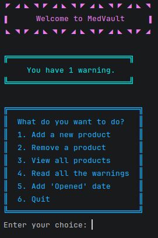

# MedVault

A Python script that makes medication management smart and easy, reducing waste and improving tidiness.

## Screenshots

## Features
- Simple and intuitive interface with Tkinter
- Colored terminal version for people who prefer simple experiences
- Possibility to choose to boot in Tkinter mode or Terminal mode

- Add and remove products, with intuitive and simple questions
- List all the products and get a nice and tidy view over your medications
- Get warnings when a product is about to expire and when it's expired
- Add opening dates to remember and know whether a product is still good for use

## How and why I made it
I made MedVault with python and with a book you can find in docs/book.pdf, made by ChatGPT, where i learned Python and its methods.
I felt the need to make this program because a lot of families, including mine, end up wasting and forgetting that they have medications and just buy others. This program was made to stop waste in pharmaceutical products and to get the list a little more tidy.

## Installing and running
WINDOWS:
1. Go to the releases page
2. Download the .exe file
3. Run the .exe file

LINUX (could change from distro to distro):
1. Go to the releases page
2. Download the ...-linux file
3. Run the ...-linux file

### Advices
- On Windows, you should and need to resize your window because some elements may appear broken on the original dimensions. I wouldn't reccomend doing this on Linux, where everything should fit nicely.
  
## FAQ

#### What operating systems does MedVault run on?

MedVault only runs with Windows and Linux, however, you can run MedVault on MacOS by downloading main.py from the assets, downloading the dependencies and running the file.

#### Does MedVault update automatically?

No, MedVault does not automatically update. If a new version rolls out, you will have to download the new file from the releases page and run the new file instead of the old one.

#### Does MedVault remember what I insert after it's closed?

No, MedVault does not have a memory function. This is in the development roadmap and will be coming soon.
