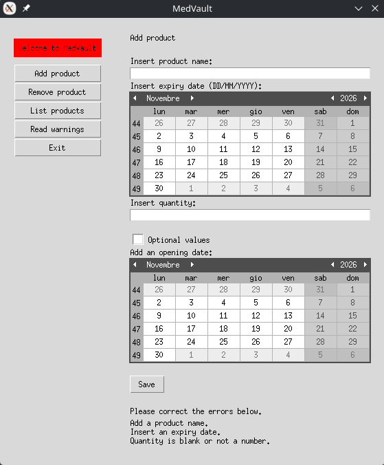

# MedVault

A Python script that makes medication management smart and easy, reducing waste and improving tidiness.

## Screenshots

MedVault Terminal

MedVault Tkinter

## Features
- Simple and intuitive interface with Tkinter
- Colored terminal version for people who prefer simple experiences
- Possibility to choose to boot in Tkinter mode or Terminal mode

- Add and remove products, with intuitive and simple questions
- List all the products and get a nice and tidy view over your medications
- Get warnings when a product is about to expire and when it's expired
- Add opening dates to remember and know whether a product is still good for use

## Installing and running

1. Go to the releases page
2. Download the .exe file
3. Run the .exe file
    
## FAQ

#### What operating systems does MedVault run on?

MedVault only runs with Windows, however, you can run MedVault on MacOS and Linux by downloading main.py from the assets, downloading the dependencies and running the file.

#### Does MedVault update automatically?

No, MedVault does not automatically update. If a new version rolls out, you will have to download the new file from the releases page and run the new file instead of the old one.

#### Does MedVault remember what I insert after it's closed?

No, MedVault does not have a memory function. This is in the development roadmap and will be coming soon.
